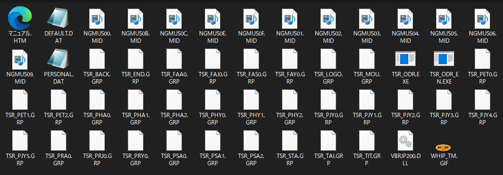
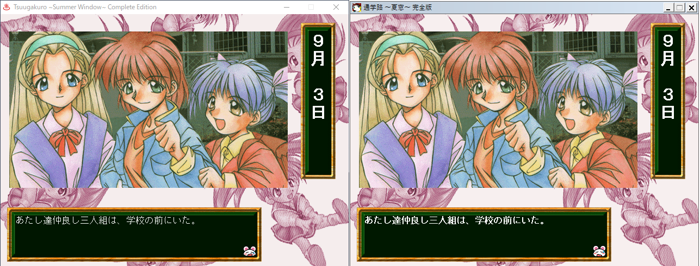
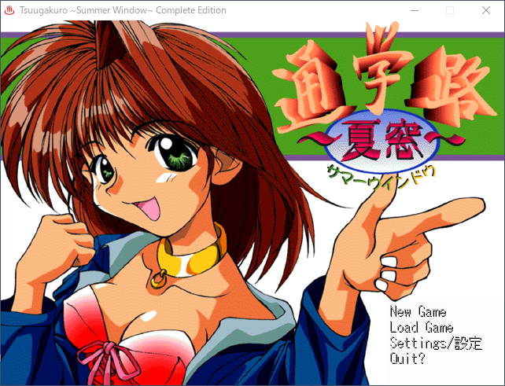
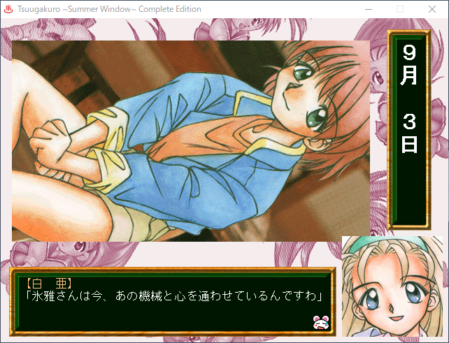
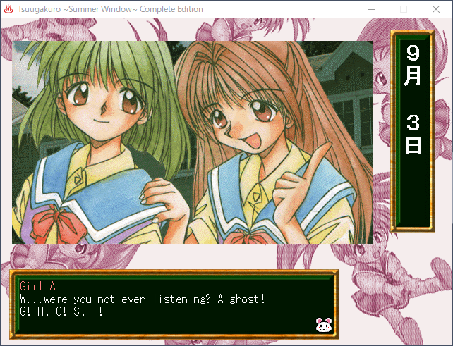

# Tsuugakuro \~Natsu Mado\~ Summer Window
*A simple handmade ONSEN Port*

## Table of Contents

- [Tsuugakuro ~Natsu Mado~ Summer Window](#tsuugakuro-natsu-mado-summer-window)
	- [Table of Contents](#table-of-contents)
	- [About this Project](#about-this-project)
	- [Installation](#installation)
		- [Installing the Original Game](#installing-the-original-game)
		- [Installing the Port](#installing-the-port)
	- [Features](#features)
		- [Finished](#finished)
		- [Planned](#planned)
		- [Unplanned](#unplanned)
	- [Screenshots](#screenshots)
	- [Original Credits](#original-credits)
	- [Port Credits](#port-credits)
	- [Software Used](#software-used)

## About this Project

**NO MACHINE TRANSLATION OR ANY OTHER FORM OF GENERATIVE AI WAS USED IN THIS PROJECT**

This is a port of the doujin novel game "通学路～夏窓～サマーウィンドウ" (Tsuugakuro ~Natsu Mado~ Summer Window) by ねころがーる (Nekoro Girl).

Tsuugakuro released in 1998 for Windows. Specifically, it released as a 16-bit Windows game meant to be played on Windows 95 or 98. This poses a problem for people hoping to enjoy the game today since you'd have to jump through a few hoops just to get the game running.

For instance, you'd have to set up a VM capable of running Windows 9x, set up a translation layer on Windows like otvdm to try and run it natively on modern Windows, or do the Linux equivalent of that with something like Wine or Proton. Or in an extreme scenario, you'd have to play it on era-appropriate hardware capable of playing Japanese games.

In my experience, the game performed really sluggishly on my 98 VM. It also just straight up refused to boot on SteamOS with the accompanying error stating that it was "out of RAM". Thankfully, otvdm seems to run this game pretty well, but that may or may not be the case for every person who could be interested in this game. 

There was also an issue with translating the game since all of the text strings were stored inside the original 16-bit executable. Unless I wanted to spend God only knows how long trying to decompile an old game in order to make a handful of textboxes slightly longer for the sake of an English translation, then I had to find a new way; a better way.

Thankfully, that came in the form of a port.

I played through the game several times, doing my best to note down which choices took me where, and the extremely simple nature of this game started to reveal itself. There are 3 total choices in the game:

The first is a sort of classic adventure game loop. How many times can you repeatedly look at/investigate/talk/etc until the game finally lets you advance? Spoiler: it's 3 times for the top option, 2 times for the bottom, and then 2 times for the middle option. No threat of branching into a bad ending or other wildly different storylines. Just a tangled mess of repetition until you can continue your linear progression.

The second is basically completely inconsequential. Both options take you to the same scene, but one of them gives you about 3 or 4 extra lines of dialogue.

The final one does actually branch into the game's two different endings...but that's it.

If I were to represent the narrative with a shape, it would be something like this:

`---8---<>---<`

Anyway, I'm trying to drive home just how simple it would be to port this game. The only real challenge left from here would be the graphics and audio.

Graphics are all 8-bit bitmap images with the unique extension of .GRP. Easy peasy. ONSEN even recognizes and displays these images properly without needing to change their extension.

Audio (music) was also just plain ol' MIDI. Again, ONSEN supports this perfectly.

I'd also need to figure out the timing. I analyzed the script in a hex editor and found how music tracks were invoked, but I could never figure out the calls for the graphics. That's fine though. I was more than okay with recreating the timings by hand since the game is an extremely short read.

And after a few short hours...I had a working version of the game in my hands. Bear in mind, it wasn't a very polished port, but you could finally play this entire game from start to finish and get both endings all without the need for VMs or translation layers.

## Installation

This repo assumes you have sourced your own copy of the game. I will not be distributing game assets through this repo. Archived copies of this game do exist online, but I cannot help you locate or set them up.

### Installing the Original Game

1) Insert the floppy diskettes into your PC
2) If you are on a PC that supports 16-bit applications
   1) Run the installer on the disk
   2) Copy the files off this machine and onto your 32 or 64-bit compatible PC
3) If you are not on a PC that supports 16-bit applications
   1) Copy the files of the Diskettes into a safe location on your hard drive
   2) Use a Virtual Machine or compatibility tool like otvdm to run the installer
4) If the game has been successfully installed, you should have a folder that looks like this:

### Installing the Port

1) Download the latest build from the Releases tab
2) Open the .zip file
3) Extract its contents into the game directory.
4) Launch `Tsuugakuro-ONSEN.exe` to make sure it was installed correctly

## Features

### Finished

* Original game script
  * Fully ported and completable in Japanese
* Multilanguage Support
  * Currently just Japanese and English
* English translation
  * The entire game is playable in English!
* Save anywhere
  * Save and reload at will using the right click menu
  * The original pre-set save points were also recreated

### Planned

* Attract Mode
  * Idling on the title screen would cause a few curated scenes to play out.
  * I can either try recreating this within the script, or I could record the original exe's opening as a video file
 
### Unplanned

* Animation toggle
  * This only affects the slide-in animation when starting a new game
  * As far as I can tell, there isn't a clean way to enable or disabled animations with ONSEN
  * I kept the menu item in for now though, so I may do this later if I ever feel the need to

## Screenshots

## Original Credits

* Produced
  * ねころがーる (Nekoro Girl)
* Programming
  * 大胆不敵 (Daitanfuteki)
* Script & Event Programming
  * MOCHA
* Art & Character Design
  * ないぺた (Naipeta)

## Port Credits

* Billy
  * Original version research
  * Porting
  * Graphics
  * Translation
  * Editing
* Aru
  * Editing
  * Playtesting
* WatashiOurs
  * Playtesting
* Haviary
  * Playtesting
* jinsucks
  * Playtesting
* Nikki Triplett
  * Playtesting
* DoodleRob
  * Playtesting

## Software Used

* otvdm
  * For running the original game on my Windows 10 machine in order to analyze it
* wxMEdit
  * my hex editor of choice
  * was instrumental in poking at the original .exe
* [ONScripter-EN](https://github.com/Galladite27/ONScripter-EN)
  * New game engine
